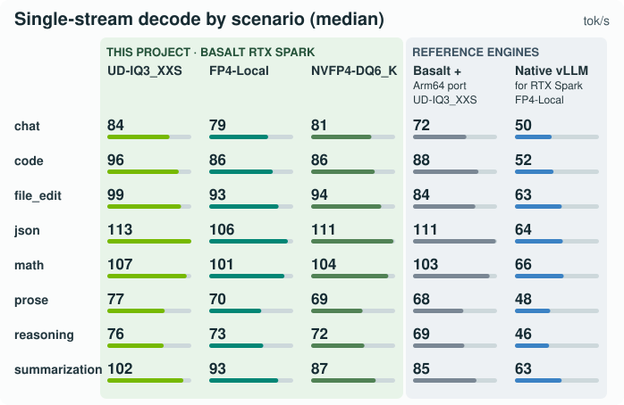
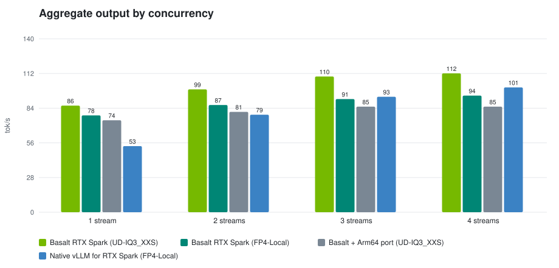

# Basalt RTX Spark

## 120B-class Qwen3.8-Flash-Next at 90.8 tokens/s on your RTX Spark laptop

**45.3 W combined CPU + GPU** for single-stream decode on Windows 11 Arm64, in the same throughput range as a desktop RTX 4080 SUPER running Strata (90.2 tok/s on IQ3_S). [Power measurements](benchmarks/results/2026-11-24-n1x-verified-default/power-method.md) · [Desktop benchmark](benchmarks/desktop-decode.md)

[Download for Windows Arm64](https://github.com/SuperDistance/basalt-rtx-spark/releases/latest) · [Setup guide](docs/rtx-spark-setup.md) · [Benchmark results](#results) · [Model packs and speeds](#quantization) · [Connect a client](docs/rtx-spark-setup.md#use-it-from-your-tools)

## Results

All three engines ran the same 392 BetterBench requests on one N1X with 128 GB of unified memory and 96 GB allocated to the GPU. Basalt RTX Spark delivered **1.68× vLLM’s single-stream decode rate** and **110.50 tok/s across four streams**. vLLM had the fastest short-prompt first token at **271 ms**.

| Engine | Weight pack tested | Weighted single-stream decode (tok/s) | Short-prompt time to first token (ms) | Four-stream mixed throughput (tok/s) |
| --- | --- | ---: | ---: | ---: |
| **Basalt RTX Spark** | `UD-IQ3_XXS` | **90.79** | 289 | **110.50** |
| Basalt + Arm64 port | `UD-IQ3_XXS` | 87.52 | 622 | 85.32 |
| vLLM for RTX Spark 0.2.0 | `FP4-Local` (NVFP4 / MXFP8) | 54.19 | **271** | 100.75 |

Cold prefill, four-stream throughput and test settings

Both Basalt engines used INT8 KV and MTP 8. vLLM used FP8 target KV, BF16 draft KV and MTP 7. In BetterBench 0.6.1 on November 24, busy GPU draw averaged 39.3 W for Basalt RTX Spark and 34.5 W for vLLM during the four-stream test. The Arm64 port ran separately on November 23 and averaged 40.8 W across busy samples over its full run. The driver did not report a GPU power limit. [November 24 measurements](benchmarks/results/2026-11-24-n1x-verified-default) · [Arm64 port measurements](benchmarks/results/2026-11-23-hp-omnibook-x-n1x-128gb/basalt-arm-sm121-2ec7a84.json)

## Quantization

Supported weight packs and measured speeds by prompt type

The documented Flash-Next weight packs for both Basalt engines include `NVFP4-DQ6_K`, `NVFP4-DQ8`, `UD-IQ1_S`, `UD-IQ1_M`, `UD-IQ2_XS`, `UD-IQ3_XXS`, `UD-IQ4_XS`, `UD-Q4_K_XL`, `UD-Q5_K_XL`, `UD-Q6_K_XL`, `Q8_0`. Basalt RTX Spark also ran NVIDIA `FP4-Local` converted to `.basalt`. The vLLM for RTX Spark 0.2.0 recipe for Flash-Next uses `FP4-Local`. The table above gives BetterBench throughput for the packs tested. [Basalt pack catalog](docs/models/qwen38-flash-next.md#pack) · [vLLM release recipes](https://github.com/devjeonghwan/vllm-for-rtx-spark/blob/e9412963ff4619da5f97f8b5e3c2dd274967df87/README.md)

Earlier N1X single-request tests measured output tokens per second for three prompt types. The ranges span two runs per pack.

| Engine / model | Weight pack | Conversation | Structured output | Prose |
| --- | --- | ---: | ---: | ---: |
| Basalt RTX Spark / Flash-Next | `UD-IQ3_XXS` | 79.0–84.1 | 141.3–147.0 | 73.3–75.4 |
| Basalt RTX Spark / Flash-Next | `FP4-Local` | 81.6–82.7 | 133.5–136.1 | 68.3–69.2 |
| Basalt + Arm64 port / Flash-Next | `NVFP4-DQ6_K` | 80.8 | 140.3 | 67.8 |
| Basalt RTX Spark / Qwen3.8-27B | `QUASAR-NVFP4` | 48.6 | 143.7 | 33.1 |

The alternating Flash-Next IQ3 and FP4-Local runs used INT8 KV, MTP 8 and fully GPU-resident experts. Busy GPU draw was 36.8–42.4 W for IQ3 and 38.4–41.4 W for FP4-Local. The Arm64 port used FP16 KV for its NVFP4-DQ6_K test. The 27B run used INT8 KV and a 16-token block drafter. The other listed packs have no comparable N1X throughput measurement in these runs. [Per-run measurements](benchmarks/results/2026-11-23-n1x-quantization) · [Arm64 port fixtures](docs/arm64.md#speed-on-the-rtx-spark-n1x)

## Running locally

Basalt places model weights across GPU memory and system RAM automatically. Flash-Next defaults to four slots with up to 262,144 tokens each and an INT8 KV cache that grows on demand. A new cold prompt can join while another conversation is decoding. Chat clients and coding agents can connect through the OpenAI- and Anthropic-compatible APIs. [Setup and client guide](docs/rtx-spark-setup.md) · [Engine changes](docs/rtx-spark-setup.md#what-changed-from-basalt) · [Quality measurements](docs/precision/)

## Credits

- [Basalt](https://github.com/jesdga95/basalt) by Jesus Gulfo and contributors (MIT): the engine this fork builds on.
- [basalt-arm-sm121](https://github.com/yanmindi/basalt-arm-sm121) (MIT): the Arm64 and compute capability 12.1 port it
  builds on.
- The projects and models Basalt credits in [README.basalt.md](README.basalt.md) and
  [THIRD_PARTY_LICENSES](THIRD_PARTY_LICENSES): Qwen's model, Unsloth's UD-IQ3_XXS quantization, and more.

## License

MIT, see [LICENSE](LICENSE).
