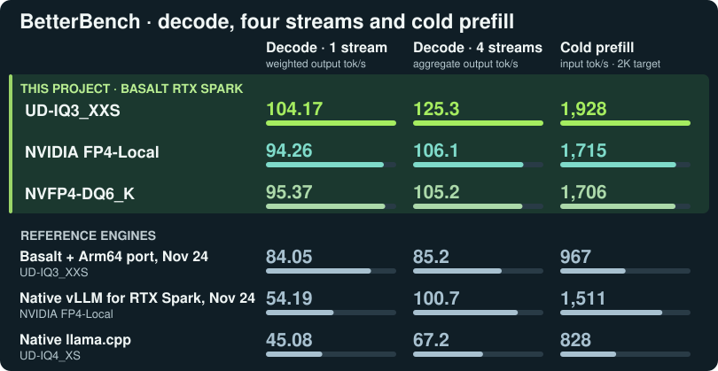

# Basalt RTX Spark

## 120B-class Qwen3.8-Flash-Next at 92.8 tokens/s on your RTX Spark laptop

With UD-IQ3_XXS weights, the N1X averaged **51.3 W across CPU and GPU** during busy decode on Windows 11 Arm64. That puts its single-stream speed in the range of a desktop RTX 4080 SUPER running Strata (90.2 tok/s on IQ3_S). [Power measurements](benchmarks/results/2026-11-24-n1x-cooled-release/release/power.json) · [Desktop benchmark](benchmarks/desktop-decode.md)

**SPEED-Bench coding on Windows Arm64** · llama.cpp **36.58 tok/s** (NVIDIA, UD-IQ4_XS) · native vLLM **70.44 tok/s** (FP4-Local). Both teams report 80 Flash-Next coding conversations using their own clients. [NVIDIA result](https://github.com/NVIDIA/local-ai-inference-recipes/blob/bb515086841e7a81e7d51925561338e7dee35023/models/qwen/qwen3.8-flash-next/rtx-spark/windows/llama-cpp/78gb/iq4-xs/vision-mtp/performance.yaml) · [vLLM result](https://github.com/devjeonghwan/vllm-for-rtx-spark/blob/e9412963ff4619da5f97f8b5e3c2dd274967df87/README.md#nvidia-reference)

[Download for Windows Arm64](https://github.com/SuperDistance/basalt-rtx-spark/releases/latest) · [Setup guide](docs/rtx-spark-setup.md) · [Benchmark results](#results) · [Model packs and speeds](#quantization) · [Connect a client](docs/rtx-spark-setup.md#use-it-from-your-tools) · [One-shot showcase](#one-prompt-one-orbital-transfer)

## Results

With the same IQ3 weights and physical cooling, Basalt RTX Spark decoded **10.4% faster** than the Arm64 port and served four streams at **31.5% higher aggregate throughput**. Every row below uses the same 392-request BetterBench preset on one 128 GB N1X with a 96 GB GPU allocation.

| Group | Engine | Weight pack tested | Weighted single-stream decode (tok/s) | Short-prompt time to first token (ms) | Four-stream mixed throughput (tok/s) |
| --- | --- | --- | ---: | ---: | ---: |
| **This project** | **Basalt RTX Spark** | `UD-IQ3_XXS` | **92.76** | 280 | **112.10** |
| **This project** | **Basalt RTX Spark** | `FP4-Local` | 84.41 | 369 | 94.13 |
| **Reference** | Basalt + Arm64 port | `UD-IQ3_XXS` | 84.05 | 619 | 85.23 |
| **Reference** | Native vLLM for RTX Spark 0.2.0 | `FP4-Local` (NVFP4 / MXFP8) | 54.19 | **271** | 100.75 |

**Cold prompts.** At the 2K target, Basalt read **1,767 input tok/s**, up **82.7%** from the port’s 967. The first token arrived in **0.88 s** versus **1.59 s** (44.8% sooner). The eight prompts per engine contained 1,522–1,593 tokens. Basalt led the port at every tested depth. At the 64K target, roughly 47,100 actual tokens, the lead was **14.5%** (2,288 vs 1,999 tok/s). Both runs used IQ3. [Raw samples and power](benchmarks/results/2026-11-24-n1x-cooled-release)

On FP4-Local, Basalt read faster at four of five depths. Native vLLM led at the 32K target (**2,123 vs 1,961 input tok/s**) and in four-stream mixed throughput. Busy decode averaged 44.55 W GPU for Basalt and 35.02 W for vLLM. The engines used different KV formats. [FP4-Local measurements](benchmarks/results/2026-11-24-n1x-fp4-local)

Decode by scenario, throughput by stream count and test settings

Basalt used four slots, INT8 KV and MTP 8 in all three runs. The two cooled IQ3 runs averaged 47.5 W GPU during busy decode on the release and 49.2 W on the port. The separate release run with FP4-Local averaged 44.55 W and read the n-gram table through the Windows file cache. The first 21 s of its opening chat phase ran on battery. Native vLLM ran earlier at 35.0 W with FP4-Local, FP8 target KV and MTP 7. Power varied across runs. [IQ3 runs](benchmarks/results/2026-11-24-n1x-cooled-release) · [FP4-Local run](benchmarks/results/2026-11-24-n1x-fp4-local) · [vLLM](benchmarks/results/2026-11-24-n1x-verified-default/vllm)

## One prompt, one orbital transfer

In **123 seconds**, Flash-Next FP4-Local turned one prompt into this animated SVG of a probe transferring between two Earth orbits, complete with burn values and flight time. [Exact prompt, original SVG and physics checks](docs/showcase/orbital-transfer)

## What the N1X fork speeds up

- **Reading a prompt.** Flash-Next selects a BF16 activation path for short NVFP4 matrix multiplies. A 716-token prompt reached its first token in 0.66 s, down from 1.37 s in the kernel comparison.
- **Serving four chats.** Flash-Next drafts for several requests in one GPU pass. Drafting took 5.42 ms per verification window versus 21.53 ms on the Arm64 port in the four-stream structured-output test.
- **Joining an active server.** A new 16,672-token prompt produced its first token in 26.17 s while all three ongoing chats were still decoding. Their longest gap was 389 ms. [Implementation and measurements](docs/rtx-spark-optimizations.md)

## Quantization

Supported weight packs and measured speeds by prompt type

The documented Flash-Next weight packs for both Basalt engines include `NVFP4-DQ6_K`, `NVFP4-DQ8`, `UD-IQ1_S`, `UD-IQ1_M`, `UD-IQ2_XS`, `UD-IQ3_XXS`, `UD-IQ4_XS`, `UD-Q4_K_XL`, `UD-Q5_K_XL`, `UD-Q6_K_XL`, `Q8_0`. Basalt RTX Spark also completed BetterBench with NVIDIA `FP4-Local` converted to `.basalt`. The vLLM for RTX Spark 0.2.0 recipe for Flash-Next uses `FP4-Local`. The table above gives BetterBench throughput for the packs tested. [Basalt pack catalog](docs/models/qwen38-flash-next.md#pack) · [vLLM release recipes](https://github.com/devjeonghwan/vllm-for-rtx-spark/blob/e9412963ff4619da5f97f8b5e3c2dd274967df87/README.md)

Earlier N1X single-request tests measured output tokens per second for three prompt types. The ranges span two runs per pack.

| Group | Engine / model | Weight pack | Conversation | Structured output | Prose |
| --- | --- | --- | ---: | ---: | ---: |
| **This project** | Basalt RTX Spark / Flash-Next | `UD-IQ3_XXS` | 79.0–84.1 | 141.3–147.0 | 73.3–75.4 |
| **This project** | Basalt RTX Spark / Flash-Next | `FP4-Local` | 81.6–82.7 | 133.5–136.1 | 68.3–69.2 |
| **This project** | Basalt RTX Spark / Qwen3.8-27B | `QUASAR-NVFP4` | 48.6 | 143.7 | 33.1 |
| **Reference** | Basalt + Arm64 port / Flash-Next | `NVFP4-DQ6_K` | 80.8 | 140.3 | 67.8 |

The alternating Flash-Next IQ3 and FP4-Local runs used INT8 KV, MTP 8 and fully GPU-resident experts. Busy GPU draw was 36.8–42.4 W for IQ3 and 38.4–41.4 W for FP4-Local. The Arm64 port used FP16 KV for its NVFP4-DQ6_K test. The 27B run used INT8 KV and a 16-token block drafter. The other listed packs have no comparable N1X throughput measurement in these runs. [Per-run measurements](benchmarks/results/2026-11-23-n1x-quantization) · [Arm64 port fixtures](docs/arm64.md#speed-on-the-rtx-spark-n1x)

## Running locally

Basalt places model weights across GPU memory and system RAM automatically. Flash-Next defaults to four slots with up to 262,144 tokens each and an INT8 KV cache that grows on demand. A new cold prompt can join while another conversation is decoding. Chat clients and coding agents can connect through the OpenAI- and Anthropic-compatible APIs. [Setup and client guide](docs/rtx-spark-setup.md) · [Engine changes](docs/rtx-spark-setup.md#what-changed-from-basalt) · [Quality measurements](docs/precision/)

## Credits

- [Basalt](https://github.com/jesdga95/basalt) by Jesus Gulfo and contributors (MIT): the engine this fork builds on.
- [basalt-arm-sm121](https://github.com/yanmindi/basalt-arm-sm121) (MIT): the Arm64 and compute capability 12.1 port it
  builds on.
- The projects and models Basalt credits in [README.basalt.md](README.basalt.md) and
  [THIRD_PARTY_LICENSES](THIRD_PARTY_LICENSES): Qwen's model, Unsloth's UD-IQ3_XXS quantization, and more.

## License

MIT, see [LICENSE](LICENSE).
