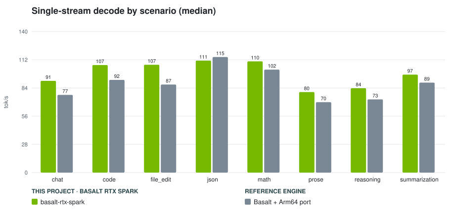

# Benchmarks

Serving results on RTX Spark machines, measured with [BetterBench](https://github.com/GGZ14/BetterBench) 0.6.1 and
one shared config, so runs on different laptops (and other Spark machines) can be compared. Contributions are welcome:
add a folder under `results/` with your run (see [Contributing a result](#contributing-a-result)).

## Results

The November 24 [four-stream scheduler comparison](results/2026-11-24-n1x-four-stream-scheduler) includes two matched structured runs per build, the complete mixed BetterBench sweep and power measurements. The adopted scheduler gained **8.1%** on four long structured replies. The joint research build measured **+0.2%** at mixed C4.

| Machine | Engine | Power state | Decode, weighted median (tok/s) | First token, short (ms) | Output at 1 / 2 / 3 / 4 streams (tok/s) | Prefill 2K / 8K / 64K (tok/s) |
| --- | --- | --- | ---: | ---: | --- | --- |
| [HP OmniBook X, N1X, 128 GB, 96 GB split](results/2026-11-23-hp-omnibook-x-n1x-128gb) | basalt-rtx-spark `25551ed` | sustained, GPU ~42 W while busy | 97.9 | 284 | 86.5 / 99.4 / 110.8 / 113.1 | 1,724 / 2,077 / 2,342 |
| [HP OmniBook X, N1X, 128 GB, 96 GB split](results/2026-11-23-hp-omnibook-x-n1x-128gb) | Basalt + Arm64 port `2ec7a84` | sustained, GPU ~41 W while busy | 87.5 | 622 | 74.6 / 81.1 / 85.7 / 85.3 | 983 / 1,506 / 2,095 |
| [HP OmniBook X, N1X, 128 GB, 96 GB split](results/2026-11-22-hp-omnibook-x-n1x-128gb-vllm) | basalt-rtx-spark `c01f9ed` | power floor (22-28 W) after ~8 min | 88.2 | 324 | 77.2 / 86.6 / 94.5 / 98.3 | 1,347 / 1,700 / 1,781 |
| [HP OmniBook X, N1X, 128 GB, 96 GB split](results/2026-11-22-hp-omnibook-x-n1x-128gb-vllm) | vLLM for RTX Spark 0.2.0, FP4-Local, MTP 7 | power floor (22-28 W) after ~8 min | 55.1 | 279 | 53.0 / 81.2 / 97.8 / 104.4 | 1,370 / 1,773 / 2,182 |

All with Qwen3.8-Flash-Next; the Basalt rows with UD-IQ3_XXS, int8 KV, four 262,144-token slots and MTP window 8.
Compare rows only within one power state.

### Single-stream decode by scenario

Against Basalt with the Arm64 port, back to back with the power budget held up:



Against vLLM for RTX Spark, both on the power floor:


The per-scenario tables, concurrency and prefill charts are in each result's folder. `plot.py` makes the same charts
from any BetterBench result files:

```
python benchmarks/plot.py --out benchmarks/img --prefix mine mine.json "My laptop" other.json "Other"
```

## Running it

1. Install BetterBench 0.6.1 (`pip install -e .` in a clone of its repository; Python 3.10+).
2. Start the server with the config you are measuring (the one these runs used is in the [top README](../README.md#building-and-running)).
3. Run, from the BetterBench checkout:

   ```
   python -m betterbench.cli run --no-update-check --endpoint http://127.0.0.1:8080/v1 --model flash-next \
     --config <this repo>/benchmarks/betterbench-config.json --max-model-len 262144 \
     --note engine=<build> --note quant=<pack> --note hardware=<machine and GPU split> \
     --name <name> --out <name>.json
   ```

   The config is BetterBench's community settings: temperature 0.7, top-p 0.95, top-k 20, a cold prefix cache, 3 warm-up
   and 20 measured passes per category, the 2K-64K prefill sweep, and 48 requests at each concurrency from 1 to 4. A run
   takes 35-45 minutes.

4. Log the GPU's power and clock beside it, for example
   `nvidia-smi --query-gpu=timestamp,pstate,power.draw,clocks.sm,temperature.gpu,utilization.gpu --format=csv -l 5 > <name>.gpu.csv`.

### The power state matters

On the N1X the GPU boosts to about 55-60 W, and on some laptops it then settles at a sustained floor of 22-28 W about
eight minutes into a load, which takes 20-40% off the later phases of a run. Holding the budget up (for example by
re-applying the laptop's performance thermal profile when it starts to decline) keeps it around 40-55 W. Say which
state your run was in and include the GPU log; compare runs only when they ran in the same state, ideally back to back.
See [GPU power on the N1X](../docs/n1x-gpu-power.md).

## Contributing a result

Add `results/<date>-<maker>-<model>-<chip>-<ram>/` with:

- the BetterBench JSON (`<engine>.json`), and the HTML report if you like;
- the GPU log (`<engine>.gpu.csv`);
- a `README.md` filled in from [TEMPLATE.md](TEMPLATE.md): the machine, the GPU memory split, driver, OS build, power
  source and mode, fan and thermal profile, anything holding the power budget up, the engine commit and server config,
  the model pack, and anything else that ran during the run.

Then add a row to the table above and open a pull request. Results from other engines on the same machine are
welcome too, run with the same config.
