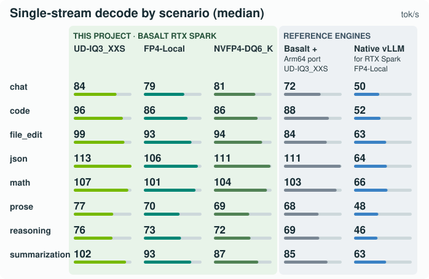

# N1X performance results

Run the [production feature coverage workloads](feature-coverage.md) alongside each BetterBench comparison. The cold-join check submits an uncached fourth prompt after three streams are producing output and verifies their progress during prefill.

Measure native Windows Arm64 serving on the RTX Spark N1X with the [shared BetterBench preset](betterbench-config.json). [Run it on your laptop](#running-it) · [Contribute a result](#contributing-a-result)

## Engine comparison

All three engines ran Qwen3.8-Flash-Next on the same RTX Spark N1X laptop with 128 GB of unified memory and a 96 GB GPU allocation. BetterBench 0.6.1 used the same 392-request workload in each run.

| Group | Engine | Weight pack tested | Weighted single-stream decode (tok/s) | Short-prompt time to first token (ms) | Four-stream mixed throughput (tok/s) |
| --- | --- | --- | ---: | ---: | ---: |
| **This project** | Basalt RTX Spark · release ZIP | `UD-IQ3_XXS` | **92.76** | 280 | **112.10** |
| **This project** | Basalt RTX Spark · source build | `FP4-Local` | 85.28 | 365 | 95.88 |
| **This project** | Basalt RTX Spark · source build | `NVFP4-DQ6_K` | 85.22 | 365 | 95.84 |
| **Reference** | Basalt + Arm64 port | `UD-IQ3_XXS` | 84.05 | 619 | 85.23 |
| **Reference** | Native vLLM for RTX Spark 0.2.0 | `FP4-Local` (NVFP4 / MXFP8) | 54.19 | **271** | 100.75 |

Basalt used four slots, INT8 KV and MTP 8. The IQ3 runs used the v0.4.1-rtx-spark.2 ZIP and the Arm64 port, averaging 47.5 and 49.2 W GPU respectively during busy decode. Native vLLM ran earlier with FP8 target KV and MTP 7. [IQ3 runs](results/2026-11-24-n1x-cooled-release) · [vLLM](results/2026-11-24-n1x-verified-default/vllm)

Both FP4 packs used the same native source build with all 24,576 GPU expert slots and Windows file caching for the n-gram table. Whole-GPU memory sampled each second during BetterBench had nearly identical medians (72.62 GiB DQ6_K, 72.77 GiB FP4-Local). The sampled peaks were **75.03 GiB** and **78.23 GiB**, respectively. DQ6_K started with 4.38 GiB of host expert backing versus 3.26 GiB for FP4-Local. During busy decode, their GPU means were 48.39 W at 73.77°C and 46.00 W at 73.11°C. A smaller GPU allocation needs a separate placement test. [Measured source](https://github.com/SuperDistance/basalt-rtx-spark/commit/1bc565f277a3fb02c6182ea5ba0e9086b3f637e0) · [DQ6_K telemetry](results/2026-11-24-n1x-nvfp4-dq6-k) · [FP4-Local telemetry](results/2026-11-24-n1x-fp4-resident-ring)

**Published SPEED-Bench coding results on Windows Arm64.** For 80 Flash-Next coding conversations, NVIDIA reports **36.58 tok/s** for llama.cpp b11901 with the three-shard UD-IQ4_XS GGUF and MTP. The native vLLM for RTX Spark project reports **70.44 tok/s** using FP4-Local and its own client. The **54.19 tok/s** in the table above is our weighted BetterBench measurement of the Windows Arm64 vLLM port. [NVIDIA measurement](https://github.com/NVIDIA/local-ai-inference-recipes/blob/bb515086841e7a81e7d51925561338e7dee35023/models/qwen/qwen3.8-flash-next/rtx-spark/windows/llama-cpp/78gb/iq4-xs/vision-mtp/performance.yaml) · [Native vLLM benchmark](https://github.com/devjeonghwan/vllm-for-rtx-spark/blob/e9412963ff4619da5f97f8b5e3c2dd274967df87/README.md#nvidia-reference)

**Cold prompt reading on IQ3.** At the 2K target the release reached 1,767 input tok/s versus 967 on the Arm64 port (+82.7%). Median time to first token fell from 1.59 to 0.88 seconds (−44.8%). Each engine processed eight prompts in this group, spanning 1,522–1,593 actual tokens across both runs. At the 64K target, around 47,100 actual tokens, throughput rose from 1,999 to 2,288 tok/s (+14.5%). Across the five tested depths the throughput gain ranged from 7.2% to 82.7%. [Per-depth samples](results/2026-11-24-n1x-cooled-release)

On FP4-Local, Basalt read prompts faster than native vLLM at four of five depths. At the 32K target, Basalt processed **1,951 input tok/s** versus **2,123** for vLLM. At that depth Basalt still loaded some expert weights from file. vLLM led in four-stream mixed throughput. Busy decode averaged 46.00 W GPU for Basalt and 35.02 W for vLLM. The engines used different KV formats. [FP4-Local measurements](results/2026-11-24-n1x-fp4-resident-ring)





**FP4 prefill under memory pressure.** With a 2,560 MiB GPU reserve, the new 64-slot staging ring saved about 844 MiB versus the 384-slot ring. The same 23,633-token prompt stayed in one chunk and staged zero expert blobs from file, down from 1,586. Across two runs per configuration, mean time to first token fell **26.7%** (14.20 and 14.16 s to 10.41 and 10.38 s). On a fresh engine with the default 700 MiB reserve, the full ring fit. At 3,072 MiB neither ring fit outside the expert cache. [Controlled measurements and output checks](results/2026-11-24-n1x-fp4-prefill-chunks)

### Published DGX Spark reference

On one GB10, NInfer `a107b983` ran Flash-Next with NVFP4 main experts, MTP 3 and FP8 KV. For a 130-token prompt and 8,192 output tokens per request, it reported **70.0 / 160.1 / 226.4 tok/s** at one, four and eight streams, counting only intervals with a full decode batch. On its separate 75-request corpus it reported **96.2 / 133.2 tok/s** at four and eight streams, dividing output tokens by total elapsed time including prefill, admission and drain. NInfer measured these on its own hardware. A direct comparison with the laptop would require the same workload and measured power on both machines. [NInfer results and methodology](https://github.com/Neroued/ninfer/blob/9ebb72ed756ecbec5dbc18ee22d58fc08575e129/docs/performance/qwen3.8-flash-next.md)

### Supported quantizations and single-stream decode rates

The documented Flash-Next weight packs for both Basalt engines include `NVFP4-DQ6_K`, `NVFP4-DQ8`, `UD-IQ1_S`, `UD-IQ1_M`, `UD-IQ2_XS`, `UD-IQ3_XXS`, `UD-IQ4_XS`, `UD-Q4_K_XL`, `UD-Q5_K_XL`, `UD-Q6_K_XL`, `Q8_0`. Basalt RTX Spark also completed BetterBench with NVIDIA `FP4-Local` converted to `.basalt`. The vLLM for RTX Spark 0.2.0 recipe for Flash-Next uses `FP4-Local`. The table above gives BetterBench throughput for the packs tested. [Basalt pack catalog](../docs/models/qwen38-flash-next.md#pack) · [vLLM release recipes](https://github.com/devjeonghwan/vllm-for-rtx-spark/blob/e9412963ff4619da5f97f8b5e3c2dd274967df87/README.md)

The two FP4 packs finished within **0.1 tok/s** of each other for weighted decode in these separate runs. Of these three packs, **UD-IQ3_XXS** had the highest weighted decode rate on this laptop. For closer agreement with BF16, the pack publisher measured **91.65%** top-token agreement for DQ6_K versus **88.67%** for IQ3 on the same 100 WikiText-2 chunks. [Publisher’s quality test](https://huggingface.co/jesdga/Qwen3.8-Flash-Next-Basalt/blob/fc721830e519ab52012d372e89b90d9a7df30ff2/README.md#quality)

Earlier N1X single-request tests measured output tokens per second for three prompt types. The ranges span two runs per pack.

| Group | Engine / model | Weight pack | Conversation | Structured output | Prose |
| --- | --- | --- | ---: | ---: | ---: |
| **This project** | Basalt RTX Spark / Flash-Next | `UD-IQ3_XXS` | 79.0–84.1 | 141.3–147.0 | 73.3–75.4 |
| **This project** | Basalt RTX Spark / Flash-Next | `FP4-Local` | 81.6–82.7 | 133.5–136.1 | 68.3–69.2 |
| **This project** | Basalt RTX Spark / Qwen3.8-27B | `QUASAR-NVFP4` | 48.6 | 143.7 | 33.1 |
| **Reference** | Basalt + Arm64 port / Flash-Next | `NVFP4-DQ6_K` | 80.8 | 140.3 | 67.8 |

The alternating Flash-Next IQ3 and FP4-Local runs used INT8 KV, MTP 8 and fully GPU-resident experts. Busy GPU draw was 36.8–42.4 W for IQ3 and 38.4–41.4 W for FP4-Local. The Arm64 port used FP16 KV for its NVFP4-DQ6_K test. The 27B run used INT8 KV and a 16-token block drafter. The other listed packs have no comparable N1X throughput measurement in these runs. [Per-run measurements](results/2026-11-23-n1x-quantization) · [Arm64 port fixtures](../docs/arm64.md#speed-on-the-rtx-spark-n1x)

The [benchmark archive](results) contains the individual runs and scheduler experiments.

From the repository root, regenerate the charts with PowerShell.

```powershell
$run = 'benchmarks/results/2026-11-24-n1x-cooled-release'
$fp4 = 'benchmarks/results/2026-11-24-n1x-fp4-resident-ring/results.json'
$dq6k = 'benchmarks/results/2026-11-24-n1x-nvfp4-dq6-k/results.json'
$vllm = 'benchmarks/results/2026-11-24-n1x-verified-default/vllm/results.json'
python benchmarks/plot.py --out benchmarks/img --prefix engines `
  "$run/release/results.json" 'Basalt RTX Spark (UD-IQ3_XXS)' `
  $fp4 'Basalt RTX Spark (FP4-Local)' `
  $dq6k 'Basalt RTX Spark (NVFP4-DQ6_K)' `
  "$run/arm-port/results.json" 'Basalt + Arm64 port (UD-IQ3_XXS)' `
  $vllm 'Native vLLM for RTX Spark (FP4-Local)'
```

## Running it

1. Install BetterBench 0.6.1 (`pip install -e .` in a clone of its repository; Python 3.10+).
2. Start the server with the config you are measuring (the one these runs used is in the [setup guide](../docs/rtx-spark-setup.md)).
3. From this repository’s root, run BetterBench in PowerShell. Set the pack and memory split to match the server you started. The build ID should identify its binary or source revision.

   ```powershell
   $build = git rev-parse --short HEAD
   python -m betterbench.cli run --no-update-check --endpoint http://127.0.0.1:8080/v1 --model flash-next `
     --config benchmarks/betterbench-config.json --max-model-len 262144 `
     --note "engine=$build" --note quant=UD-IQ3_XXS --note 'hardware=RTX Spark N1X, 96 GB GPU split' `
     --name n1x --out n1x.json
   ```

   The config is BetterBench's community settings: temperature 0.7, top-p 0.95, top-k 20, a cold prefix cache, 3 warm-up
   and 20 measured passes per category, the 2K-64K prefill sweep, and 48 requests at each concurrency from 1 to 4. A run
   takes 35-45 minutes.

4. Log the GPU's power and clock beside it, for example
   `nvidia-smi --query-gpu=timestamp,pstate,power.draw,clocks.sm,temperature.gpu,utilization.gpu --format=csv -l 1 > n1x.gpu.csv`.

### The power state matters

On the N1X the GPU boosts to about 55-60 W, and on some laptops it then settles at a sustained floor of 22-28 W about
eight minutes into a load, which takes 20-40% off the later phases of a run. Holding the budget up (for example by
re-applying the laptop's performance thermal profile when it starts to decline) keeps it around 40-55 W. Say which
state your run was in and include the GPU log; compare runs only when they ran in the same state, ideally back to back.
See [the GPU power measurements](results/2026-11-24-n1x-verified-default/power-method.md).

## Contributing a result

Add `results/<date>-<maker>-<model>-<chip>-<ram>/` with:

- the BetterBench JSON (`<engine>.json`), and the HTML report if you like;
- the GPU log (`<engine>.gpu.csv`);
- a `README.md` filled in from [TEMPLATE.md](TEMPLATE.md): the machine, the GPU memory split, driver, OS build, power
  source and mode, fan and thermal profile, anything holding the power budget up, the engine commit and server config,
  the model pack, and anything else that ran during the run.

Then add a row to the table above and open a pull request. Results from other engines on the same machine are
welcome too, run with the same config.

Archived BetterBench files identify the test machine by model in the `env.host` field. System hostnames and user profile paths can be omitted from contributed runs.
