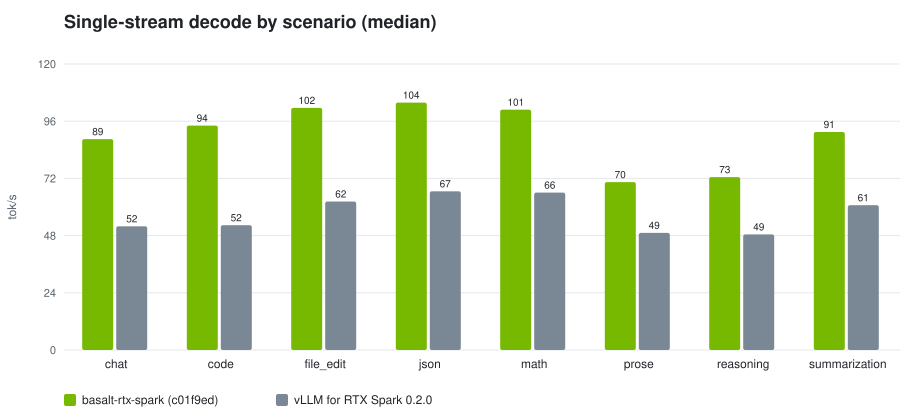
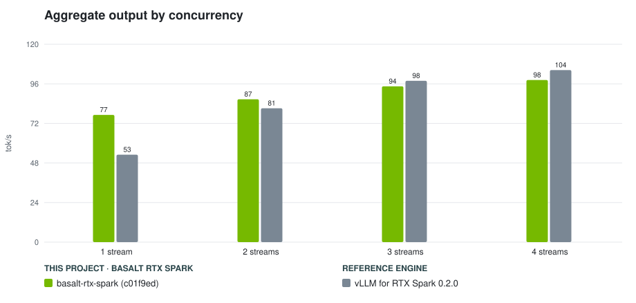
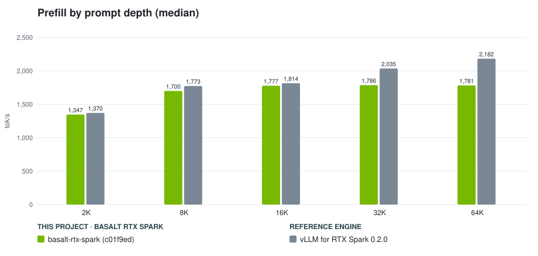

# 2026-11-22/23, HP OmniBook X, N1X, 128 GB: against vLLM for RTX Spark

| | |
| --- | --- |
| Machine | HP OmniBook X, NVIDIA RTX Spark N1X, 128 GB unified memory, 96 GB GPU split |
| Driver, OS | NVIDIA 621.24; Windows 11 on Arm64, build 28000 |
| Power | AC; HP Performance profile; nothing holding the power budget up, so each run settles on the firmware's sustained floor (22-28 W) about eight minutes in |
| Engines | vLLM for RTX Spark 0.2.0 (vLLM 0.32.0): FP4-Local (NVIDIA's NVFP4 checkpoint), its default recipe: MTP 7 with block verification, fp8 KV, Marlin weight-only NVFP4 experts. basalt-rtx-spark `c01f9ed`: UD-IQ3_XXS, int8 KV, four 262,144-token slots, MTP window 8 |
| Benchmark | BetterBench 0.6.1, [betterbench-config.json](../../betterbench-config.json) |
| When | vLLM 2026-11-22 21:46, basalt-rtx-spark 2026-11-23 04:43, each on a freshly started server |

Each engine runs its own pack, the one it is built for, so this compares the two as a user would run them, not the
same weights. Both runs sat on the same power floor after their first minutes, but they were not back to back.

## Results

| Scenario | basalt-rtx-spark | vLLM for RTX Spark |
| --- | ---: | ---: |
| chat | 88.5 | 51.9 |
| code | 94.2 | 52.4 |
| file_edit | 101.6 | 62.3 |
| json | 103.8 | 66.6 |
| math | 100.8 | 66.1 |
| prose | 70.5 | 49.1 |
| reasoning | 72.6 | 48.5 |
| summarization | 91.5 | 60.8 |
| **weighted** | **88.2** | **55.1** |

| | basalt-rtx-spark | vLLM for RTX Spark |
| --- | ---: | ---: |
| First token, short prompts, p50 (ms) | 324 | 279 |
| Output at 1 / 2 / 3 / 4 streams (tok/s) | 77.2 / 86.6 / 94.5 / 98.3 | 53.0 / 81.2 / 97.8 / 104.4 |
| Prefill at 2K / 8K / 16K / 32K / 64K (tok/s) | 1,347 / 1,700 / 1,777 / 1,786 / 1,781 | 1,370 / 1,773 / 1,815 / 2,035 / 2,182 |

Files: `basalt-rtx-spark.json` and `vllm-rtx-spark-0.2.0.json` (BetterBench). No GPU logs were kept for these two runs.
