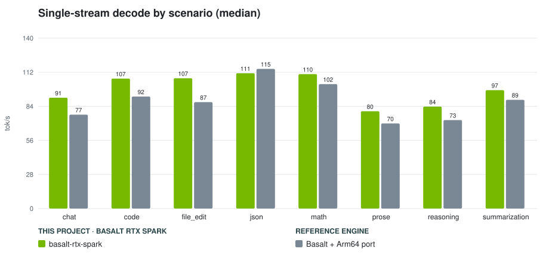
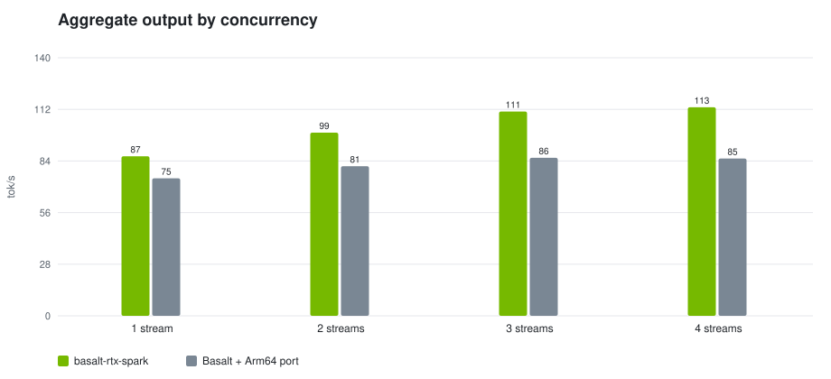
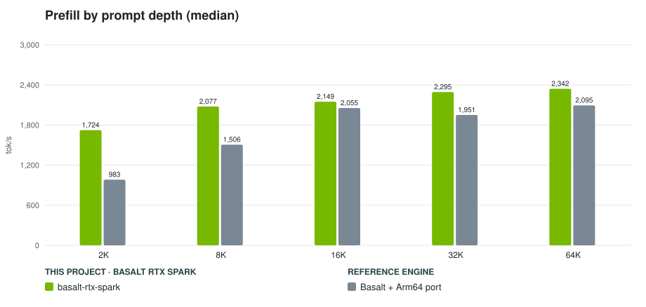

# 2026-11-23, HP OmniBook X, N1X, 128 GB

| | |
| --- | --- |
| Machine | HP OmniBook X, NVIDIA RTX Spark N1X, 128 GB unified memory |
| GPU memory split | 96 GB |
| Driver, OS | NVIDIA 621.24; Windows 11 on Arm64, build 28000 |
| Power | AC; HP Performance thermal profile (fan Performance), CPU EPP 0, GPU uncapped |
| Power budget | held up: a helper re-applies the HP thermal profile whenever the GPU's power budget starts declining (every 2-6 minutes under load), pausing at 92 C SoC and resuming below 85 C |
| Engines | basalt-rtx-spark `25551ed` and Basalt with the Arm64 port (yanmindi/basalt-arm-sm121 `2ec7a84`), both built with MSVC ARM64, CUDA 13.5, `sm_121`, Release |
| Server config | the same for both: four 262,144-token slots (`slot-full-context`), int8 KV, MTP window 8, prompt checkpoints on, the conversation cache's RAM and disk tiers off (see the [setup guide](../../../docs/rtx-spark-setup.md#install)) |
| Model pack | Qwen3.8-FN-UD-IQ3_XXS.basalt (Unsloth's UD-IQ3_XXS mix, converted to Basalt's format); every routed expert on the GPU at load in both runs |
| Benchmark | BetterBench 0.6.1, [betterbench-config.json](../../betterbench-config.json) |
| During the run | nothing else on the GPU, except a 20-second fp16 GEMM about 20 minutes into the 2ec7a84 run |

basalt-rtx-spark ran from 11:23 to 11:55, then 2ec7a84 from 12:18 to 12:56, each on a freshly started server.

## Results

| | Reference · Basalt + Arm64 port `2ec7a84` | This project · Basalt RTX Spark `25551ed` |
| --- | ---: | ---: |
| Decode, weighted median (tok/s) | 87.5 | 97.9 |
| First token, short prompts, p50 (ms) | 622 | 284 |
| Output at 1 / 2 / 3 / 4 streams (tok/s) | 74.6 / 81.1 / 85.7 / 85.3 | 86.5 / 99.4 / 110.8 / 113.1 |
| First token at 4 streams, p50 / p99 (ms) | 727 / 2,351 | 430 / 1,326 |
| Prefill at 2K / 8K / 16K / 32K / 64K (tok/s) | 983 / 1,506 / 2,055 / 1,951 / 2,095 | 1,724 / 2,077 / 2,149 / 2,295 / 2,342 |
| GPU while busy: mean power, clock, temperature | 40.8 W, 2,072 MHz, 76 C | 42.3 W, 2,063 MHz, 77 C |

### Single-stream decode by scenario

| Scenario | Reference · Basalt + Arm64 port `2ec7a84` | This project · Basalt RTX Spark `25551ed` |
| --- | ---: | ---: |
| chat | 77.1 | 91.1 |
| code | 92.0 | 106.8 |
| file_edit | 87.4 | 107.1 |
| json | 114.8 | 111.2 |
| math | 102.2 | 110.4 |
| prose | 69.9 | 80.0 |
| reasoning | 72.7 | 83.7 |
| summarization | 89.3 | 97.3 |
| **weighted** | **87.5** | **97.9** |

`json` is within both runs' spread (interquartile range 23-26 tok/s); every other scenario is faster here.

Files: `basalt-rtx-spark.json`, `basalt-arm-sm121-2ec7a84.json` (BetterBench), and their `.gpu.csv` logs (every 5 s).
The first JSON's notes name the build by its development commit, `004d287`; its code is `25551ed` here.
