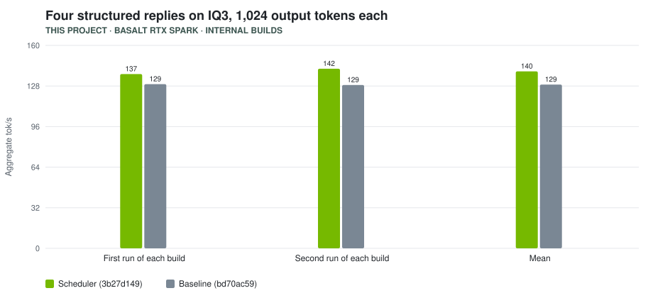
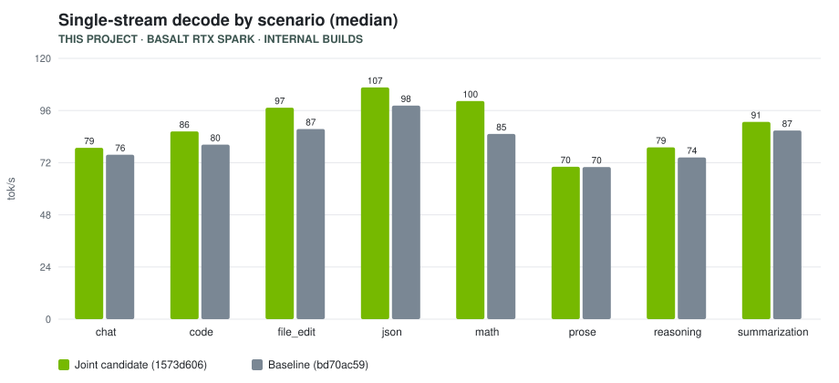
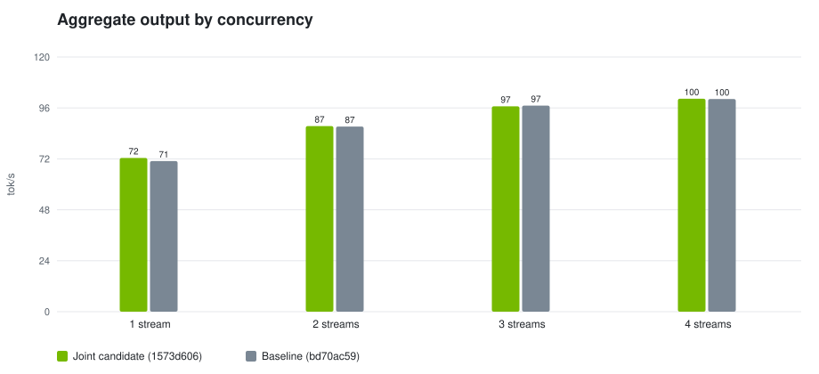
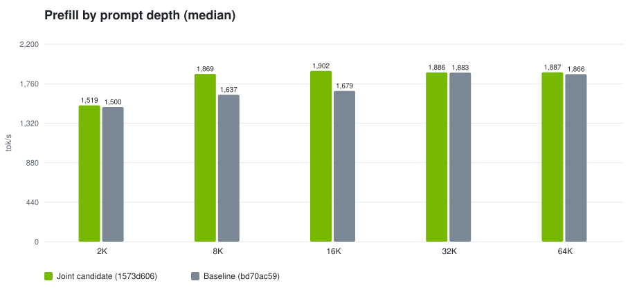

# Four-stream scheduling on RTX Spark N1X

On November 24, 2026, Flash-Next UD-IQ3_XXS ran on a 128 GiB Windows ARM64 laptop with a 96 GiB GPU split and INT8 KV. The [scheduler source](https://github.com/SuperDistance/basalt-rtx-spark/tree/3b27d1494d7b9b4e564b98644c72ac3b36a04580) is on `n1x-performance`. Both comparisons below use baseline `bd70ac59`.

## Scheduler alone

Four simultaneous requests each generated 1,024 structured output tokens. Prompts, seeds and expert placement were fixed. Runs alternated baseline, scheduler, scheduler, baseline. Each row reports the mean of two runs. The scheduler matched all 1,536 output IDs in a separate four-slot greedy check.

| Build | Output (tok/s) | GPU draw (W) | GPU clock (MHz) | CPU + GPU + NPU (W) | Tokens per measured joule |
| --- | ---: | ---: | ---: | ---: | ---: |
| Baseline | 129.10 | 20.98 | 1,622 | 32.26 | 4.01 |
| Scheduler | 139.52 | 21.82 | 1,603 | 32.51 | 4.29 |

Throughput increased **8.1%** and tokens per measured joule increased **7.2%**. The power sum covers the three measured components. Firmware TDP was unavailable. [Per-run measurements](scheduler.json)

## BetterBench 0.6.1

The full-suite candidate `1573d606` included the scheduler and an experimental solo expert kernel. Each build completed 160 single-stream requests, 192 mixed-concurrency requests and 40 cold-prefill requests. The historical preset used sampled output. Only the scheduler was adopted.

| Metric | Baseline | Joint candidate |
| --- | ---: | ---: |
| Weighted single-stream decode (tok/s) | 81.64 | 87.04 |
| Short-prompt median first token (ms) | 322 | 318 |
| Mixed throughput at 1 / 2 / 3 / 4 streams (tok/s) | 70.93 / 87.24 / 97.10 / 100.18 | 72.42 / 87.45 / 96.75 / 100.34 |
| Four mixed streams, median first token (ms) | 524 | 531 |
| Four mixed streams, busy GPU draw (W) | 21.16 | 21.67 |

Decode used automatic placement and compilation overlapped part of the baseline. The fixed-output solo controls measured −0.2% on conversation and −0.7% on prose. Mixed concurrency and prefill used 24,576 resident expert slots and 1 GiB of host backing in both arms. The mixed sweep’s median busy clock was 1,631 MHz at every level.

At nominal 16K prefill, the joint candidate reached 1,902 versus 1,679 prompt tok/s, with median busy clocks of 1,449 versus 1,287 MHz and GPU draw of 26.0 versus 23.0 W. The apparent 13.3% gain is power-confounded. At nominal 64K (about 47K actual model tokens) throughput rose 1.1% at 26.9/26.8 W baseline/candidate.

[Baseline measurements](baseline.json) · [Joint candidate measurements](candidate.json) · [Power by concurrency and prompt depth](power.json)
