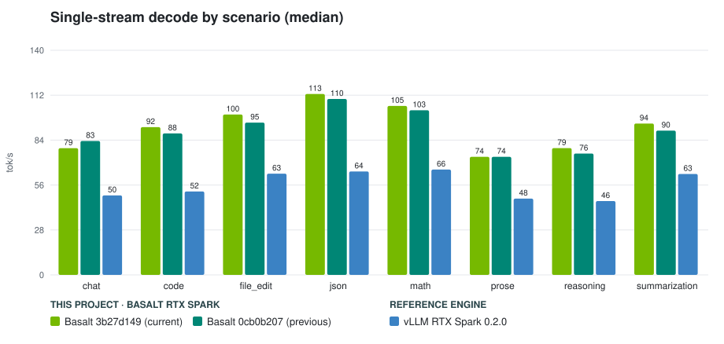
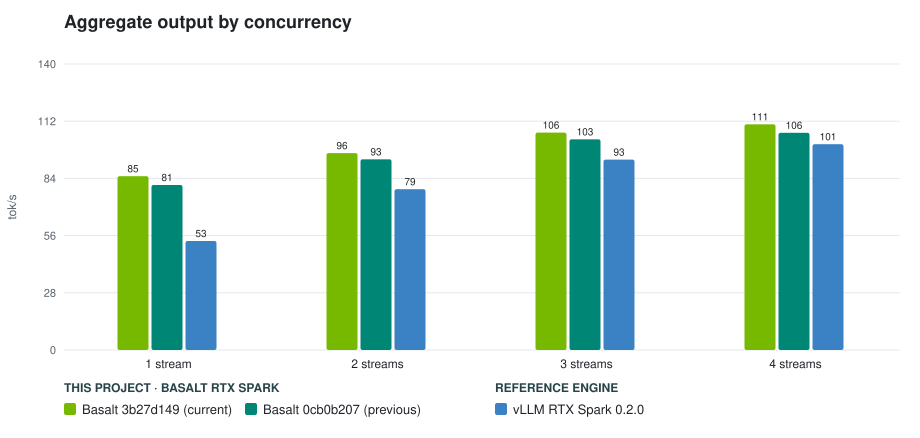
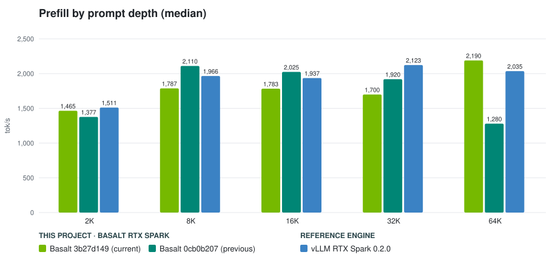

# Verified default engine on RTX Spark N1X

On November 24, 2026, BetterBench 0.6.1 ran from 10:44 to 11:18 against the versioned `3b27d149` Basalt executable. At 11:25, after the benchmark and controls, the same binary hash was verified and promoted to the unversioned local default. The hash matched the official candidate recorded in `effective-default.json`. The source checkout was `3c3a4caf`, whose `src/`, `include/`, `tests/` and `CMakeLists.txt` trees match the measured `3b27d149` engine snapshot exactly. The previous local default, `0cb0b207`, was retained for rollback and replay. The exact unversioned executable was separately smoke-tested after all suites: [`default-smoke.json`](default-smoke.json) records the matching SHA-256, four 262,144-token slots, INT8 KV, spec 8 and a successful three-token response.

The test ran on an HP OmniBook X with an RTX Spark N1X, 128 GiB system RAM, a 96 GiB GPU memory split, Windows 11 on Arm64, NVIDIA driver 621.24, AC power and the Balanced power plan. Flash-Next used UD-IQ3_XXS, INT8 KV, four 262,144-token slots and speculative window 8. The driver did not report a GPU power limit. The exact BetterBench preset and summary are included under `basalt/`.

## BetterBench 0.6.1

| Metric | This project · Basalt `3b27d149` (current) | This project · Basalt `0cb0b207` (previous) | Reference engine · vLLM RTX Spark 0.2.0 |
| --- | ---: | ---: | ---: |
| Weighted single-stream decode | 90.79 tok/s | 87.55 tok/s | 54.19 tok/s |
| Short-request median TTFT | 289 ms | 304 ms | 271 ms |
| Mixed aggregate output at 1 / 2 / 3 / 4 streams | 85.09 / 96.36 / 106.41 / 110.50 tok/s | 80.79 / 93.33 / 103.14 / 106.34 tok/s | 53.38 / 78.70 / 93.21 / 100.75 tok/s |
| Four-stream median TTFT | 443 ms | 458 ms | 455 ms |
| Cold prefill at nominal 2K / 8K / 16K / 32K / 64K | 1,465 / 1,787 / 1,783 / 1,700 / 2,190 tok/s | 1,377 / 2,110 / 2,025 / 1,920 / 1,280 tok/s | 1,511 / 1,966 / 1,937 / 2,123 / 2,035 tok/s |

All 392 BetterBench requests completed for each of the three runs, with zero reported cache hits. The old-default-to-current comparison was +3.7% weighted decode (87.55 → 90.79 tok/s), −4.8% short TTFT (303.7 → 289.1 ms) and +3.9% mixed C4 output (106.34 → 110.50 tok/s). Automatic RAM backing differed: 3.32 GiB for the old default and 1.74 GiB for the current build, both started with a full cache of 24,576 GPU expert groups; scratch loans on the old build temporarily reduced that to 22,509 during the deep prompt. The builds used different weight and KV formats: Basalt ran UD-IQ3_XXS with INT8 KV and MTP window 8; vLLM used NVIDIA FP4-Local weights, FP8 target KV, BF16 draft KV and block MTP 7. The comparison does not establish equal model quality.

NVIDIA samples during the Basalt C4 interval reported a busy mean GPU draw of 38.98 W and median SM clock of 2,021 MHz. The complete aligned SparkHelper power comparison is in [common-power.json](common-power.json). At C4, mean busy GPU draw was 41.45 W for the old default, 39.33 W for current Basalt and 34.46 W for vLLM; mean measured CPU+GPU+NPU draw was 45.68, 44.19 and 41.90 W respectively. Busy SM clocks were 2,232.5, 2,034 and 2,060 MHz. The candidate improved while its clock and power were lower than the old-default replay. The vLLM NVIDIA CSV missed its final roughly 42 seconds at shutdown: the C4 interval has 148 samples across about 191 seconds, 146 above the 80% busy threshold. Those NVIDIA values are retained as partial and are not used for the direct comparison in the [power-method note](power-method.md). Phase power extraction and sample counts are in [old-default power.json](old-default/power.json), [Basalt power.json](basalt/power.json) and [vLLM power data](vllm/). The full BetterBench outputs are [old default](old-default/results.json), [Basalt](basalt/results.json) and [vLLM](vllm/results.json), with per-scenario summaries in their `summary.json` files.

## Default-width and serving controls

Four simultaneous fixed-output structured replies averaged **138.97 tok/s** on baseline `bd70ac59` and **152.18 tok/s** on the promoted scheduler build `3b27d149` (**+9.5%**). This A/B/B/A control is separate from the official replay of former local default `0cb0b207`. This A/B/B/A comparison had a declining clock and power trend across the session, so the individual measurements and their power conditions matter; see the [control details](controls/README.md).

The automatic verifier-row trace records 95 eight-row windows and 185 sixteen-row-budget windows, including 183 actual 16-row windows and two actual 15-row windows. Both serving-arrival checks passed. An uncached 16,672-token prompt joined three active decodes at 26.96 s TTFT while each incumbent continued generating. In the reverse direction, a 49,966-token cold prompt yielded to a short request, which finished first at 1.66 s; the long read then resumed from token 4,096. The [control package](controls/) includes the per-arm metrics, telemetry, verification records and row-budget trace.

At 64K nominal prefill, the old default measured 1,280 tok/s and current Basalt 2,190 tok/s (+71%), but GPU power and clock were also 24.18 W / 1,111 MHz versus 41.62 W / 1,846 MHz; treat that as confounded. At nominal 8K, 16K and 32K, current Basalt measured slower than the old default. See the [per-depth power data](old-default/power.json) and [deep-prompt residency evidence](old-default/deep-prompt-residency.json). The earlier November 22–23 comparisons and the November 24 scheduler microbenchmark remain available in the [previous result folders](../2026-11-24-n1x-four-stream-scheduler) and the [benchmark index](../../README.md).
