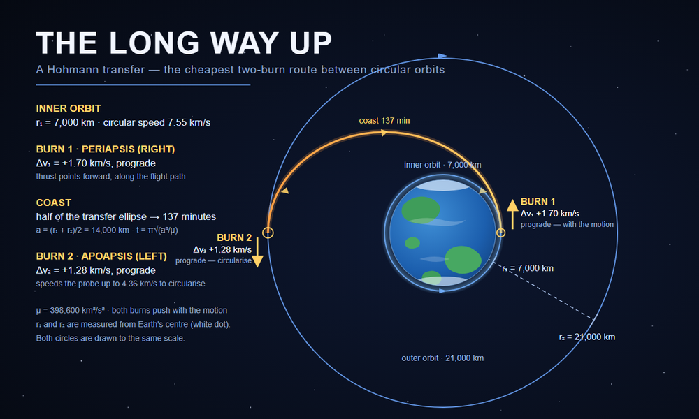

# The Long Way Up

One user message asked Qwen3.8-Flash-Next to **calculate, draw and animate a transfer between two Earth orbits**. Basalt served NVIDIA’s FP4-Local weights on a 128 GiB RTX Spark N1X laptop running Windows Arm64. The full-size SVG is the model’s exact visible reply. [Original SVG](artwork.svg) · [Exact prompt and sampling settings](request.json) · [Run metadata](run.json)



## What the model got right

| Test | Independently checked result |
| --- | --- |
| First burn | Raising the opposite side of the orbit takes **1.69594 km/s**. The drawing rounds to **1.70 km/s** and points the large burn arrow up at the right edge of the inner orbit. |
| Second burn | Matching the outer orbit takes another **1.27605 km/s**. The drawing gives **1.28 km/s** and points the large arrow down at the left edge. Both burns point in the direction of travel. |
| Coast time | Half the transfer period is **137.38 minutes**, rounded to **137** on the poster. |
| Geometry and motion | The circles share a center and have radii of **100 and 300 pixels**. The transfer ellipse has semiaxes of **200 and 173.205 pixels**, putting Earth at one focus. The probe follows its upper half from right to left and both ends meet their circles tangentially. The native animation repeats every **8 seconds**. |

The numerical check uses the given Earth gravitational parameter, 398,600 km³/s², and a transfer semimajor axis of 14,000 km. At each burn, compare the circular speed √(μ/r) with the transfer speed √[μ(2/r − 1/a)]. The coast takes π√(a³/μ) seconds. [Hohmann transfer equations](https://orbital-mechanics.space/orbital-maneuvers/hohmann-transfer.html)

**Look closely.** The two large burn arrows point correctly, but two small direction markers point backward. Earth covers the white center dot named in the caption, and the outer orbit crosses the subtitle. The probe’s uniform animation speed and flickering exhaust are schematic. The preview preserves these details.

## How the run was made

The model received the same user message on three independent API calls. It received no example, critique, previous response or tool result. Two high-effort calls stopped at their effective output limits before closing the SVG. The third used medium reasoning effort and a 32,768-token output cap. It finished on its own in **123.33 s** with **11,092 completion tokens**, including reasoning, and zero cached prompt tokens. The renderer sampled the original SVG at 12 frames per second to produce the looping WebP. The SVG retains the model’s native animation.

| Call | Settings and outcome |
| --- | --- |
| 1 | High effort, 16,384 requested and generated tokens. The SVG ended mid-element. [Request](attempts/1-request.json) · [Visible reply](attempts/1-truncated.txt) |
| 2 | High effort, 32,768 requested with an explicit 12,288-token reasoning budget. The released server logged an effective output cap of 12,288 and returned that many tokens. The SVG ended mid-element. [Request](attempts/2-request.json) · [Visible reply](attempts/2-truncated.txt) |
| 3 | Medium effort, temperature 0.6, top-p 0.95, seed 17, one user message. The reply was a complete 1200 × 720 SVG. [Request](request.json) · [Exact reply](artwork.svg) |

We chose FP4-Local because it measured **84.41 tok/s** on single-stream BetterBench and had lower mean divergence from BF16 than the faster UD-IQ3_XXS pack in the project’s 100-chunk test (**0.089 vs 0.118**). This example tests one visual reasoning task. [FP4-Local BetterBench](../../../benchmarks/results/2026-11-24-n1x-fp4-local) · [Quantization quality comparison](../../../benchmarks/results/2026-11-22-hp-omnibook-x-n1x-128gb-vllm)

To try the same prompt, start the [local server](../../rtx-spark-setup.md) with the FP4-Local pack and model alias `flash-next`. From this directory, send the saved request in PowerShell.

```powershell
curl.exe -sS http://127.0.0.1:8080/v1/chat/completions -H "Content-Type: application/json" --data-binary "@request.json" -o response.json
```
