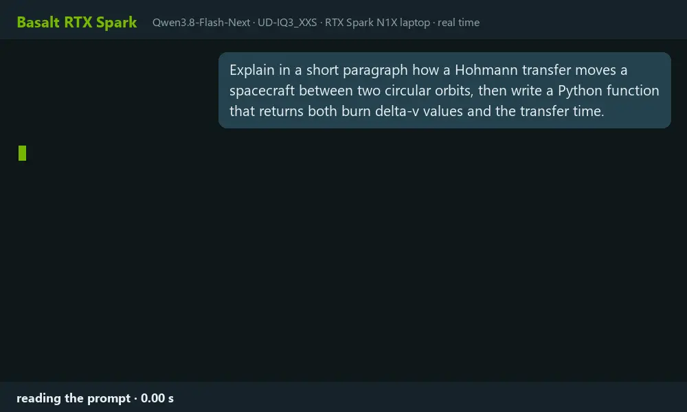

# One chat in real time

Qwen3.8-Flash-Next answering one request on an RTX Spark N1X laptop: the source build of Basalt RTX Spark
(`209a14bb`, the engine on `main`), the `UD-IQ3_XXS` pack, the default server settings, thinking off. The animation
replays the recorded stream at its recorded timing. Each frame shows exactly the text that had arrived by that moment.

| | |
| --- | --- |
| Output | 970 tokens |
| First token | 0.12 s |
| Last token | 9.29 s |
| Decode | 105.7 tok/s (tokens after the first, over the time from first to last) |

The server was started fresh, warmed up with one request, and then given three recorded requests, each after the GPU
had idled cool for 120 s. They decoded at 102.3, 102.1 and 105.7 tok/s. This clip is the 105.7 one. A single code-heavy
answer runs faster than BetterBench's weighted figure (98.9 tok/s), which also covers slower scenarios such as prose
and reasoning.

## Files and reproduction

- [stream.json](stream.json): the request settings, every update's arrival time and text, and the server's token count
- [capture.py](capture.py): records a stream like it (`python capture.py http://127.0.0.1:8080/v1 stream.json`)
- [render.py](render.py): replays it as an animated WebP (`python render.py stream.json chat.webp`, needs Pillow)
